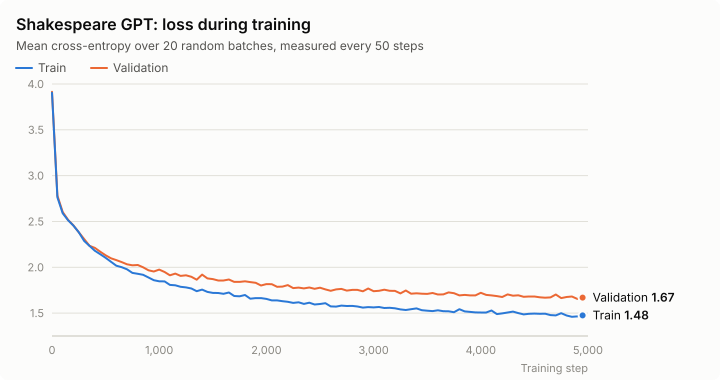

# nano-torch

A small deep learning framework I wrote from scratch in NumPy.

After a machine learning course at the LSE Summer School I built an MNIST classifier from scratch and derived all the gradients by hand. After that I wanted to understand how PyTorch finds the gradients for any model you give it. That turned into this project: an autograd engine, a PyTorch-like `nn` / `optim` API and in the end a character-level GPT trained on Shakespeare.

The only dependency is NumPy and everything runs on the CPU.

## From MNIST to GPT

### 1. MNIST by hand

[Experiments/manual_mnist.py](Experiments/manual_mnist.py) is a two-layer MLP for MNIST that only uses NumPy arrays. The forward pass is

```math
Z_1 = XW_1 + b_1,\quad A_1 = \mathrm{ReLU}(Z_1),\quad Z_2 = A_1W_2 + b_2,\quad \hat{Y} = \mathrm{softmax}(Z_2)
```

and I derived the backward pass by hand. With softmax and cross-entropy the gradient of the logits becomes very simple and the rest is just the chain rule:

```math
\frac{\partial L}{\partial Z_2} = \frac{1}{N}(\hat{Y} - Y),\qquad
\frac{\partial L}{\partial W_2} = A_1^\top \frac{\partial L}{\partial Z_2},\qquad
\frac{\partial L}{\partial Z_1} = \left(\frac{\partial L}{\partial Z_2} W_2^\top\right) \odot \mathbb{1}[Z_1 > 0]
```

This gets about 96% test accuracy after 5 epochs (256 hidden units, plain SGD). The problem is that for every new layer or model you have to derive and write all the gradients again.

### 2. Autograd

[tensor.py](tensor.py) does the backward pass automatically. A `Tensor` wraps a NumPy array and every operation (`+`, `*`, `@`, `exp`, `log`, `sum`, indexing, reshape etc.) stores

- the tensors it was computed from
- a `_backward` function with its local derivative

`loss.backward()` sorts the graph topologically and goes through it from the output back to the inputs. Each node multiplies the incoming gradient with its local derivative and adds the result to the gradients of its inputs:

```math
\frac{\partial L}{\partial x} \mathrel{+}= \frac{\partial L}{\partial y}\cdot\frac{\partial y}{\partial x}
```

The backward pass also undoes broadcasting, so the gradient always has the same shape as the input.

To check that it works, [Experiments/comparison.py](Experiments/comparison.py) runs the framework and the hand-written network for a few SGD steps from the same starting weights on the same batches. After each step it compares the loss, all gradients and the weights. They match up to float64 rounding error.

The tests in [tests/](tests/) check every operation and layer (up to the full GPT) against a numerical gradient:

```math
\frac{\partial L}{\partial x_i} \approx \frac{L(x_i + \varepsilon) - L(x_i - \varepsilon)}{2\varepsilon}
```

This doesn't use the backward pass at all, so it's an independent check.

### 3. Building the framework

On top of the autograd I wrote:

- [nn.py](nn.py): the layers (`Module`, `Linear`, `ReLU`, `GELU`, `Sequential`, `LayerNorm`, `Embedding`, `Dropout`, `MultiHeadAttention`, `Block`, `GPT`) and `cross_entropy`
- [optim.py](optim.py): `SGD`, `Adam` and `clip_grad_norm`
- [data.py](data.py): MNIST loading, batching, a character tokenizer and text batching

With this the MNIST network is only a few lines ([train.py](train.py)) and a deeper network just needs more layers ([train_mnist_deep.py](train_mnist_deep.py)). Both train in a few seconds:

| Script | Model | Epochs | Test accuracy |
| --- | --- | --- | --- |
| `train.py` | 784 → 128 → 10 | 5 | ~95.7% |
| `train_mnist_deep.py` | 784 → 256 → 128 → 10 | 10 | ~97.6% |

### 4. Shakespeare GPT

[train_gpt.py](train_gpt.py) trains a small decoder-only transformer on Tiny Shakespeare that predicts the next character from the previous 64. Each block has causal multi-head attention

```math
\mathrm{Attention}(Q, K, V) = \mathrm{softmax}\left(\frac{QK^\top}{\sqrt{d_k}} + M\right)V
```

($M$ is the causal mask with $-\infty$ above the diagonal) and a feed-forward layer with GELU. Both use pre-norm and residual connections.

The default model has a vocabulary of 65 characters, $`d_{\text{model}} = 128`$, 4 heads and 4 layers (about 0.8M parameters). It is trained with Adam, gradient clipping and dropout. 5,000 steps take about 20 minutes on my Mac:

<picture>
  <source media="(prefers-color-scheme: dark)" srcset="images/gpt_loss_dark.svg">
  
</picture>

Most of the improvement happens in the first 1,000 steps. After that the validation loss only goes down slowly and the gap to the train loss gets bigger, so the model starts to overfit.

[sample.py](sample.py) loads the trained model and generates text from a prompt. This is the output for `Hamlet:`:

```text
Hamlet: how be your soul crave at rage to you lours?

KING RICHARD II:
And myself Leet a nature exece thou do before himself.
The bold son, make Greed, all even viscal on your gage.

POLIXENES:
If so!

DUKE VARICENTER:
Have grace take made, citizens me not.

LUCIO:
A dangerous banish, thou hast unplease!
```

Most of the words are made up, but it clearly learned what a play looks like: speaker names in capitals with a colon, line breaks and punctuation, even though it only works with single characters.

## Setup

```bash
python -m venv .venv
source .venv/bin/activate
pip install -r requirements.txt
```

## Datasets

The datasets aren't included in the repo. Put them in these folders:

```
nano-torch/
├── mnist_dataset/
│   ├── train-images.idx3-ubyte
│   ├── train-labels.idx1-ubyte
│   ├── t10k-images.idx3-ubyte
│   └── t10k-labels.idx1-ubyte
└── text_dataset/
    └── input.txt
```

- MNIST: [Kaggle](https://www.kaggle.com/datasets/hojjatk/mnist-dataset). The files there already have the right names.
- Tiny Shakespeare: [input.txt](https://raw.githubusercontent.com/karpathy/char-rnn/master/data/tinyshakespeare/input.txt) from Andrej Karpathy's char-rnn repo.

## Running

Run all scripts from the root of the repo.

| Command | What it does |
| --- | --- |
| `python Experiments/manual_mnist.py` | Trains the hand-written NumPy network and saves the weights to `model_checkpoints/` |
| `python Experiments/manual_mnist_test.py` | Tests those weights on the MNIST test set |
| `python Experiments/comparison.py` | Compares the autograd with the hand-derived gradients |
| `python train.py` | Trains an MLP with the framework |
| `python train_mnist_deep.py` | Same, but with two hidden layers |
| `python train_gpt.py` | Trains the Shakespeare GPT and saves checkpoints to `gpt_checkpoints/` |
| `python sample.py` | Generates text from `gpt_checkpoints/gpt_shakespeare.npz` |

The MNIST scripts take a few seconds and the GPT about 20 minutes, because everything runs in NumPy on the CPU. You can change `MAX_STEPS` and the model size at the top of `train_gpt.py`.

In `sample.py` you can type a prompt, press Enter without a prompt to start from nothing or type `STOP` to quit. The prompt can only contain characters that appear in the training text.

### Tests

```bash
pip install -r requirements-dev.txt
pytest
```

The tests take a few seconds and don't need the datasets. Apart from the gradient checks they test the causal mask, dropout, the optimisers, gradient clipping, dtypes, saving and loading checkpoints, the tokenizer and text batching. There is also a test that checks a small GPT can overfit a single batch.

## Using the framework

The API is similar to PyTorch:

```python
from data import get_batches, load_mnist_images, load_mnist_labels
from nn import Sequential, Linear, ReLU, cross_entropy
from optim import SGD
from tensor import Tensor, NoGrad

X = load_mnist_images("mnist_dataset/train-images.idx3-ubyte")
Y = load_mnist_labels("mnist_dataset/train-labels.idx1-ubyte")

model = Sequential(Linear(784, 128), ReLU(), Linear(128, 10))
optimizer = SGD(model.parameters(), lr=0.1)

for X_batch, Y_batch in get_batches(X, Y, batch_size=128):
    optimizer.zero_grad()
    loss = cross_entropy(model(Tensor(X_batch)), Y_batch)
    loss.backward()
    optimizer.step()

with NoGrad():  # no graph is built during evaluation
    predictions = model(Tensor(X)).data.argmax(axis=1)
```

Some notes:

- For a custom layer subclass `Module` and implement `forward`. `model.parameters()` finds all `Parameter`s, also inside nested modules and lists.
- Operations made from existing `Tensor` operations (like `LayerNorm`, `GELU` and `softmax`) get their gradients automatically. A completely new operation needs its own `_backward` in `tensor.py`.
- `NoGrad()` turns off building the graph and `EvalMode()` from `nn.py` turns off dropout. Use both for evaluation and sampling.
- `cross_entropy(logits, targets)` expects integer class ids. The logits can have shape `(B, C)` (MNIST) or `(B, T, C)` (GPT).
- `save_gpt_weights` and `load_gpt_weights` in [checkpoints.py](checkpoints.py) save the config, vocabulary and weights in one `.npz` file.
- Tensors are float32 by default. For exact gradient checks set `tensor.DTYPE = "float64"` before creating any tensors (like `comparison.py` does). `tensor.set_seed(...)` makes initialisation and dropout reproducible.

## What's next

- Porting it to [MLX](https://github.com/ml-explore/mlx) so it can run on the Apple Silicon GPU, since NumPy on the CPU is the main bottleneck. MLX's API is very close to NumPy, so I think it should mostly be a matter of swapping the array backend in `tensor.py`.
- A subword tokenizer like BPE instead of single characters. At the moment the model spends a lot of its capacity on learning how to spell, and with subword tokens the same context length would cover more text.
- More layers and loss functions, e.g. convolutions, other normalisation layers, RNNs, MSE and binary cross-entropy.
